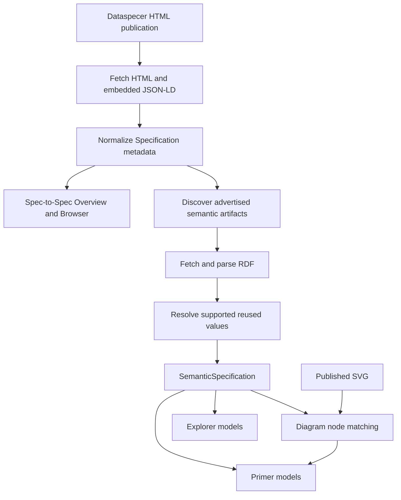

# Architecture

[Project home](../README.md) · [Developer guide](developer-guide.md) · [Known limitations](limitations.md)

This document explains **how the Dataspecer Specification Reader is structured and how published data becomes UI content**. For commands, tests, and maintenance workflows, see the [developer guide](developer-guide.md).

## System overview

The reader is a **client-side single-page application** built with Vue 3, TypeScript, and Vite. Vue Router handles hash-based navigation, N3 parses RDF, and D3 supports the Spec-to-Spec relationship graph. GitHub Pages serves the static build. There is no application server, database, or proxy: the browser requests published resources directly.

The **metadata path** supports Spec-to-Spec without semantic RDF loading. The **semantic path** runs when Primer or Explorer needs detailed class/property information. The SVG is a separately published visual artifact matched to semantic terms; it is not treated as a complete RDF source.

## Source boundaries

| Area | Responsibility |
| --- | --- |
| `src/app/` | Application shell, routing, view navigation, themes, presentation mode, URL restoration |
| `src/state/specification-state.ts` | Shared reactive publication metadata and loading/presentation state |
| `src/data/loading/` | HTML/JSON-LD acquisition, RDF artifact discovery, semantic fetching, internal dependency discovery |
| `src/data/normalization/` | Conversion of embedded JSON-LD into normalized publication metadata |
| `src/data/model/` | Publication metadata, artifacts, relationships, localized strings |
| `src/data/semantic/` | RDF parsing, vocabulary/application-profile models, reuse resolution |
| `src/pages/` | Loader and reader views, including page-specific display models |
| `src/shared/`, `src/main.css` | Shared presentation components and styles |

Some vocabulary and DSV application-profile model/parser code was adapted from Dataspecer into this repository and maintained locally. It is not automatically updated from an upstream package.

## Data acquisition and interpretation

### 1. Publication metadata

`load-specification-from-url.ts` fetches the supplied HTML documentation page and reads its embedded `application/ld+json` blocks. `normalize-specification.ts` converts supported publication structures into a `Specification` containing metadata, artifacts, and related specifications. Localized values are retained until presentation chooses a language.

The normalized model includes related-specification identities and publication links where provided. Relationships are derived from supported `isProfileOf` structures, not general-purpose inference over all possible ontology predicates.

### 2. Spec-to-Spec display models

The overview and browser builders map the normalized `Specification` to display-ready values. The overview reports publication metadata and artifact/relationship statistics. The browser displays immediate supported relationships, differentiating discoverable published specifications from external resources according to the available metadata structure—not hostname or author identity.

This stage does **not** require RDF downloads. Counts of relationships and artifacts should not be interpreted as counts of semantic classes/properties.

### 3. Semantic loading

`load-semantic-specification.ts` discovers advertised RDF artifacts using publication metadata (rather than only filenames). It fetches supported artifacts and uses N3 with the local vocabulary/DSV parsers to construct a `SemanticSpecification` with class/property information, provenance, and warnings.

Primer and Explorer request semantic loading independently when their specification watchers run. Request caching is limited to a semantic-load invocation; there is no shared persistent semantic cache or background prefetch from Spec-to-Spec. Navigating between pages may cause repeat fetching/parsing.

### 4. Reused values and dependency boundaries

For supported DSV reuse declarations, the semantic loader follows discoverable **internal published-specification** dependencies. `resolve-reused-values.ts` can resolve supported labels, definitions, and usage notes from downloaded RDF, including reuse chains.

Dependencies enrich values without replacing the current publication's local class identities or adding dependency classes to its class list. Arbitrary external term IRIs are not automatically dereferenced. Missing values remain unknown; see [known limitations](limitations.md#reused-terms-from-external-vocabularies).

## Core models and invariants

| Model | Location | Role |
| --- | --- | --- |
| `Specification` | `src/data/model/specification.ts` | Normalized publication metadata, artifacts, and immediate relationships |
| `RelatedSpecification` | `src/data/model/specification-relation.ts` | Related resource identity, link, relation, and available classification |
| `LocalizedString` | `src/data/model/localized-string.ts` | Preserves translated source strings |
| `SemanticSpecification` | `src/data/semantic/semantic-specification.ts` | Parsed local vocabulary/profile data, provenance, warnings, and reuse information |
| Page models | `src/pages/*/model/` | UI-oriented projections of already acquired data |

**Invariants:** use IRIs for semantic identity; keep missing information distinct from a negative/optional value; keep cardinality distinct from requirement level; do not let inherited values overwrite local class identity; keep acquisition/parsing out of pure display-model builders.

## View architecture

### Spec-to-Spec

**Specification Overview** presents title, description, type information where available, publication statistics, and artifacts. **Specification Browser** uses a list, D3 graph, and selected-item panel to inspect immediate normalized relationships. The browser is not intended to visualize all RDF term dependencies.

### Primer

Primer combines selected key concepts, a requirement matrix, resources, and an available published SVG. `selectKeyConcepts` prioritizes classes marked `main`, then diagram discovery order and source order, up to eight concepts; this is a presentation heuristic, not an objective domain-importance ranking.

`InteractiveSvgDiagram.vue` fetches the SVG, removes selected unsafe elements/attributes, and supports selection, keyboard interaction, and viewport controls. `match-diagram-term.ts` matches diagram nodes to parsed semantic terms by exact identifier first, then unique normalized label. Ambiguous nodes remain unmatched and can show diagram-only text. No generated replacement diagram is currently provided when the publication has no SVG.

### Specification Explorer

Explorer displays main/supportive classes, selected class context, property search and filters, configurable columns, details, and local reference navigation. It initially prefers up to two main classes.

Code view uses the same selected classes with an independent property-inclusion model to produce **TypeScript interfaces**, **JSON Schema**, or **illustrative Turtle**. Generation currently resides in `SpecExplorerView.vue`, supported by selection/reference helpers in its model directory. The output is not a complete conformance validator.

## State, routing, and localization

`src/state/specification-state.ts` exports a shared Vue reactive object (not a Pinia store) for loaded publication metadata and shared state. View-specific selections and semantic results remain local to the relevant pages. Theme and simple/detailed preferences are persisted in browser local storage.

`src/app/router.ts` uses hash routes and preserves the `specificationUrl` query parameter. `src/app/App.vue` can restore publication metadata from that URL after a refresh or direct visit. The parameter identifies a live publication; it does not store a downloaded snapshot. When neither a source URL nor loaded data is available, reader views show a shared no-specification state.

Presentation chooses localized text using the detected publication language, its base language, and available English/Czech/untagged fallbacks. No translation service or manual content-language selector is provided.

## Design boundaries

- **Read-only presentation:** The reader consumes published artifacts rather than editing source models.
- **Progressive disclosure:** Simple/detailed presentation and expandable sections control visibility without changing semantic source data.
- **Source fidelity:** Absent or unresolved information remains visibly incomplete instead of being guessed.
- **Partial interoperability:** Supported Dataspecer HTML/JSON-LD and advertised RDF structures are required; this is not a universal HTML/RDF specification importer.
- **Browser-dependent access:** CORS, HTTPS, artifact availability, and slow dependencies can affect loading.

For precise behavior and unresolved constraints, refer to [known limitations](limitations.md). For regression tests and browser verification, see the [developer guide](developer-guide.md).